<a href="https://aravindravi.io">
  
</a>

<p align="center">
  <a href="https://aravindravi.io"><b>aravindravi.io</b></a>&nbsp;&nbsp;·&nbsp;&nbsp;<a href="https://www.linkedin.com/in/-aravindravi/">LinkedIn</a>&nbsp;&nbsp;·&nbsp;&nbsp;<a href="https://YOUR-HANDLE.substack.com">Substack</a>
</p>

Product manager, ex-founder, technical by obsession. I started in power electronics for data centers, worked through healthtech, fintech, edtech, Web3, non-profit tech and agentic AI, and came back to grid-scale energy. Below: my career as a commit history, the builds I’m proudest of, and the calls that shaped them.

## Career, as a commit history


<sub>Psst: read the hashes.</sub>

<details>
<summary>Plain-text log</summary>

```text
c0ffee1  (HEAD -> main)  feat: open to full-time PM roles · Boston, MA
ba77e12  (energy)        feat: priced a $220M data-center bid · LG ES Vertech · 2025
ed0ca7e  (northeastern)  merge: MS Information Systems · Northeastern · 2024–26
dec1de5  (ai)            revert: AI visual content · not enterprise-grade · 2024
6a0b7e2  (ai)            feat: zero to MVP in 6 months, 20+ integrations · Unilytics · 2024
f1e1d05  (non-profit)    feat: data, design + AI for 120+ NGOs · Tech4Dev · 2023
c01ec7a  (web3)          feat: India's first NFT e-commerce, $1.5M+ Q1 · KoineArth · 2021
b007ed1  (edtech)        init: co-founded, bootstrapped to $250K+ · UnivSense · 2020
5ca1ab1  (fintech)       perf: disbursements 10x, 4–5h → <2h · Propelld · 2019
7e3b5c1  (healthtech)    fix: doctor churn, retention +15% · HealthPlix · 2018
3a91f0c  (energy)        first commit: HV/MV power electronics · Brown Electrical · 2018
```

</details>

## Featured builds

<p>
  <a href="https://cortex-analytics.streamlit.app/"></a>
  <a href="https://signalscout-dev.streamlit.app/"></a>
</p>

**CORTEX** ranks battery storage sites by commercial risk, reading every health metric against contract SLAs instead of in isolation. I wrote the PRD and built it end to end with Claude Code. The LLM writes the prose; every number is computed deterministically. [Live app](https://cortex-analytics.streamlit.app/)

**SignalScout** decides which arXiv papers deserve your attention. Three LLM evaluators judge rigor, novelty and shippability in parallel, and a contextual Thompson Sampling bandit learns which one you trust. [Live app](https://signalscout-dev.streamlit.app/) · [Repo](https://github.com/aravindravi7/Madison-Agent-Streamlit-App)

## The call

Every role here came down to a few decisions. Here’s what I chose, and what it cost.

| Where | The call | Over | What it cost |
|---|---|---|---|
| LG ES Vertech | A fast-build contract AI agent | A full development cycle | Some retrieval depth: it occasionally missed relevant documents |
| Unilytics | Cut AI visual content from the MVP | Shipping the diffusion prototype we’d built | A built feature, because quality wasn’t enterprise-grade |
| KoineArth | A social-login wallet with a one-tap exit to MetaMask | Seed phrases and browser extensions | Crypto-native users, and NFTs leaving the platform |
| Propelld | Vendor e-sign and KYC integrations | Building in-house | Higher costs; control stayed, and the speed was unmatched |
| Tech4Dev | A single-URL settings panel for Glific | Staying inside the design scope | Extra backend work |

## Writing

Essays and case studies on product judgment, AI systems and the calls behind them.

<!-- BLOG-POST-LIST:START -->
<!-- BLOG-POST-LIST:END -->

## Stack

```yaml
# stack.yml
build:    [Python, SQL, R, Java, Streamlit, PySpark, Databricks, Delta Lake]
ai:       [Claude Code, Anthropic API, OpenAI API, GraphRAG, RAG pipelines, Thompson Sampling]
data_viz: [Tableau, Power BI, Looker Studio, Plotly, Mixpanel]
design:   [Figma, FigJam, Moqups, Balsamiq, Lucidchart]
ship:     [Jira, Confluence, Linear, Notion, Git, Postman]
cloud:    [AWS, GCP, Azure]
```

## Off the clock

```console
~ $ cat off-the-clock.txt
football most weeks, irrationally competitive about it
sim racing, and remapping ECUs on the VAG platform
Malayalam cinema, defended at length
Sierra Trails, the hillside stay I run in Idukki, Kerala
```

<details>
<summary><code>~ $ sudo hire aravind</code></summary>

```console
[sudo] password for recruiter: ********
Permission granted.

role:       Product Manager / Technical PM, across AI, data and energy
location:   Boston, MA; open to relocation and remote
available:  MS graduation, December 2026
next step:  aravindravi.io, then hit Request CV
```

</details>

<p align="center"><sub>Made it this far? Ask the chatbot on <a href="https://aravindravi.io">aravindravi.io</a> something hard.</sub></p>
